# MVP — O que faz um chamado de suporte demorar?

Trabalho final da disciplina (MVP), Departamento de Engenharia de Produção — Universidade de Brasília.
Pipeline de dados em nuvem (Databricks) sobre chamados de suporte de uma empresa de TI.

**Autora:** Amanda Ribeiro Teixeira Lima — matrícula 190083786

## Sumário
1. [Objetivo](#1-objetivo)
2. [Coleta](#2-coleta)
3. [Modelagem](#3-modelagem)
4. [Carga](#4-carga)
5. [Análise](#5-análise) (inclui 5.4 Viabilidade e custo de operação)
6. [Autoavaliação](#6-autoavaliação)
7. [Estrutura do repositório](#7-estrutura-do-repositório)

---

## 1. Objetivo

### Pergunta norteadora
O que faz um chamado de suporte demorar para ser resolvido: a prioridade dele, o quanto ele precisa
ser escalado, ou quantas pessoas precisam se envolver até a solução?

### Problema
Empresas de software recebem chamados de clientes todos os dias. Quando um chamado demora para ser
atendido ou resolvido, ou passa por muitas mãos, o cliente fica insatisfeito e o custo do atendimento
sobe. Este MVP busca entender como o tempo de atendimento se relaciona com a prioridade, com o
aprofundamento (escalonamento) e com o número de pessoas envolvidas, para apoiar decisões sobre onde
melhorar o processo de suporte.

### Hipótese
Chamados que precisam ser escalados ou repassados mais vezes demoram significativamente mais para
serem resolvidos, mesmo quando comparados com chamados de mesma prioridade.

### Perguntas de negócio
1. Quanto tempo um chamado leva, desde a abertura, até receber o primeiro atendimento?
2. Quanto tempo um chamado leva até ser resolvido, e como esse tempo varia por prioridade?
3. Que proporção dos chamados é de fato resolvida, e quantos precisam ser reabertos depois de dados
   como resolvidos?
4. Até ser resolvido, quantas vezes um chamado é repassado ou escalado e quantas pessoas diferentes
   acabam se envolvendo nele?
5. Mais reatribuições e mais pessoas envolvidas significam uma resolução mais lenta?

---

## 2. Coleta

| Item | Registro |
|---|---|
| Base | Incident management process enriched event log |
| Fonte | [UCI Machine Learning Repository](https://archive.ics.uci.edu/dataset/498/incident+management+process+enriched+event+log) |
| Origem dos dados | Log de eventos real e anonimizado de chamados de uma empresa de TI, extraído da plataforma ServiceNow |
| Autores (citação) | Amaral, C.; Fantinato, M.; Peres, S. (2018) |
| Licença | [Creative Commons Attribution 4.0 International (CC BY 4.0)](https://creativecommons.org/licenses/by/4.0/legalcode): permite compartilhar e adaptar para qualquer finalidade, com o crédito apropriado |
| Data da coleta | 14/10/2026, às 21:45 |
| Arquivo obtido | `incident_event_log.csv` (CSV dentro de um .zip), 44,1 MB |
| Volume | 141.712 linhas (eventos), 24.918 chamados distintos, 36 colunas originais |
| Envio à nuvem | Upload pela interface do Databricks (*Create table*), gerando a tabela Delta `workspace.default.incident_event_log` |
| Tabela bruta do trabalho | `workspace.suporte.incidentes_bronze` (cópia fiel + colunas de linhagem `_data_carga` e `_arquivo_origem`) |

Notebook: [`notebooks/01_coleta.py`](notebooks/01_coleta.py) — explicação célula a célula em
[`notebooks/01_coleta_explicacao.md`](notebooks/01_coleta_explicacao.md).

**Evidências**

Detalhes da tabela criada pelo upload (formato Delta, persistida no catálogo):

Volume coletado:

Consulta SQL à tabela bruta:

---

## 3. Modelagem

A base original é um log de eventos (cada linha é uma atualização de um chamado). Como as perguntas
falam sobre chamados, o modelo é um **Esquema Estrela** com uma tabela fato de **uma linha por
chamado**, ligada a quatro dimensões.

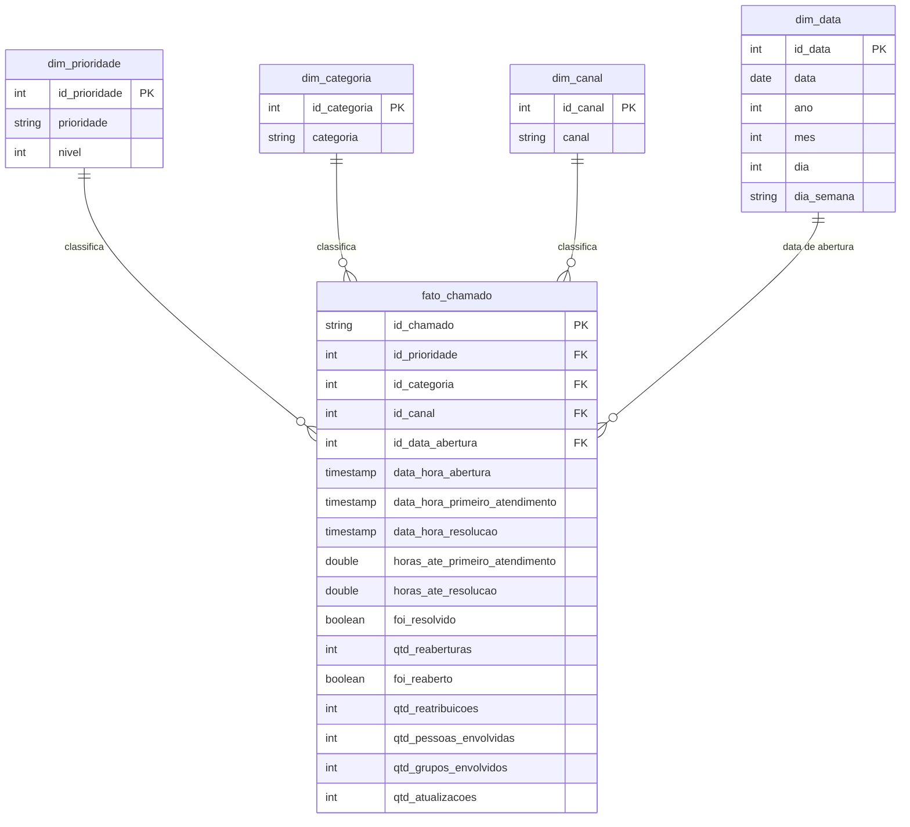

| Pergunta | Medida da fato | Dimensão |
|---|---|---|
| 1. Tempo até o primeiro atendimento | `horas_ate_primeiro_atendimento` | `dim_prioridade` |
| 2. Tempo até a resolução, por prioridade | `horas_ate_resolucao` | `dim_prioridade` |
| 3. Proporção resolvida e reabertos | `foi_resolvido`, `foi_reaberto`, `qtd_reaberturas` | — |
| 4. Repasses e pessoas envolvidas | `qtd_reatribuicoes`, `qtd_pessoas_envolvidas`, `qtd_grupos_envolvidos` | — |
| 5. Reatribuições e pessoas x tempo | `qtd_reatribuicoes`, `qtd_pessoas_envolvidas` x `horas_ate_resolucao` | `dim_prioridade` |

Detalhes do modelo e regras de negócio: [`catalogo/modelo_dados.md`](catalogo/modelo_dados.md).
Catálogo de Dados (tipos, domínios e linhagem): [`catalogo/catalogo_dados.md`](catalogo/catalogo_dados.md).

---

## 4. Carga

Notebook: [`notebooks/02_carga.py`](notebooks/02_carga.py) — explicação célula a célula em [`notebooks/02_carga_explicacao.md`](notebooks/02_carga_explicacao.md).

### Pipeline de ETL no Databricks
O pipeline é executado por um **Job** do Databricks (`pipeline_suporte`) com quatro tarefas em sequência:
`01_coleta` (extração e carga da camada bronze) → `02_carga` (transformação e carga do modelo estrela) →
`03_qualidade` (verificações de qualidade) → `04_analise` (respostas às perguntas de negócio).
Cada tarefa só roda se a anterior terminar com sucesso, e o pipeline completo roda de ponta a ponta com um clique.

Fluxo dos dados: `incidentes_bronze` (bruto, 1 linha por evento) → `incidentes_prata` (tratado, 1 linha por evento) →
`fato_chamado` + `dim_prioridade`, `dim_categoria`, `dim_canal`, `dim_data` (modelo estrela, 1 linha por chamado).
Todas as tabelas são Delta, no schema `workspace.suporte` do Databricks.

### Regras de negócio aplicadas na transformação
| Regra | Descrição |
|---|---|
| R1 | O texto `?` (informação ausente na fonte) é convertido em nulo em todas as colunas |
| R2 | Datas convertidas de texto (`d/M/yyyy H:mm`) para data e hora |
| R3 | Contadores (`reassignment_count`, `reopen_count`, `sys_mod_count`) convertidos para inteiro |
| R4 | Campos verdadeiro/falso (`active`, `made_sla`, `knowledge`, `u_priority_confirmation`) convertidos para booleano |
| R5 | Prioridade, categoria, canal e data de resolução vêm da última atualização do chamado (maior `sys_mod_count`; empate pelo `sys_updated_at` mais recente) |
| R6 | Primeiro atendimento (aproximação): menor `sys_updated_at` entre os eventos com estado válido diferente de "New" (o estado inválido `-100` é ignorado) |
| R7 | Pessoas e grupos envolvidos: contagem de valores distintos não nulos de `assigned_to` e `assignment_group` |
| R8 | Reatribuições, reaberturas e atualizações: maior valor registrado entre os eventos do chamado |
| R9 | Tempos em horas: diferença entre as datas, em segundos, dividida por 3.600 |
| R10 | Resolvido: estado final do chamado é "Resolved" ou "Closed" |
| R11 | Reaberto: chamado com pelo menos uma reabertura |
| R12 | Deduplicação de eventos: linhas idênticas em todas as colunas são mantidas uma única vez |
| R13 | Tempos negativos (impossíveis) viram nulo e não entram nas médias |

### Regras agrupadas por tipo
| Tipo de regra | Como foi aplicada |
|---|---|
| Tratamento de ausentes e inválidos | R1: o `?` da fonte vira nulo, para não ser contado como pessoa, grupo ou categoria. R6: o estado inválido `-100` não conta como atendimento. R13: tempos negativos viram nulo |
| Conversão de tipos e de unidade | R2 a R4: texto convertido em data, inteiro e booleano. R9: diferenças de tempo convertidas de segundos para horas |
| Deduplicação | R12: eventos idênticos removidos. R5: as várias linhas de evento de um chamado viram uma única linha na fato (grão: 1 linha por chamado) |
| Padronização de chaves | `number` sem espaços nas pontas vira `id_chamado`; dimensões recebem chaves numéricas (`id_prioridade` = número da prioridade; `id_categoria` e `id_canal` sequenciais em ordem alfabética); a data recebe chave no formato AAAAMMDD |
| Junção | Estado final do chamado + medidas calculadas sobre todos os eventos (junção pelo `id_chamado`); fato + dimensões (junção `left`, para não perder chamados sem categoria ou canal) |
| Conciliação | A base tem uma única fonte, então não há dois conjuntos externos a conciliar. A conciliação feita é entre camadas: o número de chamados da bronze deve ser igual ao da fato |

### Conferência da carga
| Verificação | Resultado |
|---|---|
| Linhas na `fato_chamado` | 24.918 |
| Chamados distintos na fato | 24.918 (nenhum repetido) |
| Chamados distintos na tabela bruta | 24.918 (nenhum perdido) |
| Chamados sem prioridade | 0 |
| Chamados sem data de abertura | 0 |
| Eventos duplicados removidos (R12) | 0 (a base não tinha eventos repetidos) |

A carga preservou todos os chamados da fonte, com exatamente uma linha por chamado e as chaves
obrigatórias preenchidas.

### Evidências
- Job `pipeline_suporte` com as quatro tarefas encadeadas (coleta → carga → qualidade → análise):
  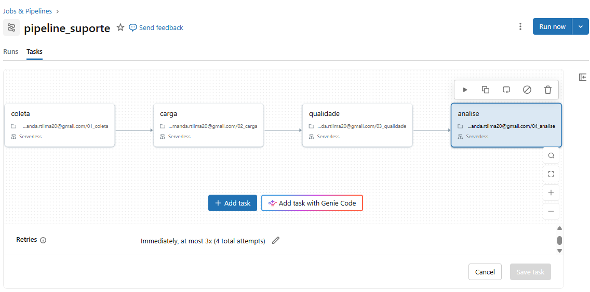
- Execução do Job completo concluída com sucesso em 18/10/2026 (4 tarefas, total 4 min 38 s):
  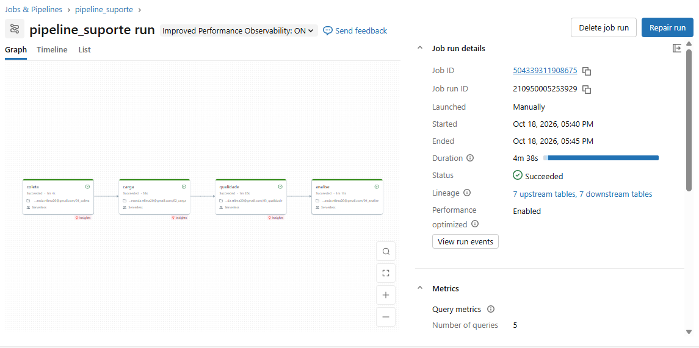
- Conferência da carga (célula 11):
  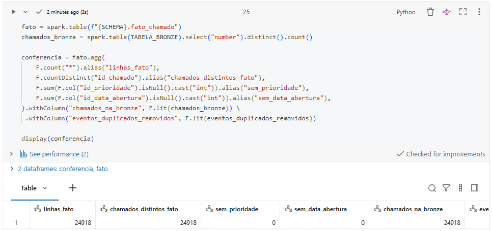
  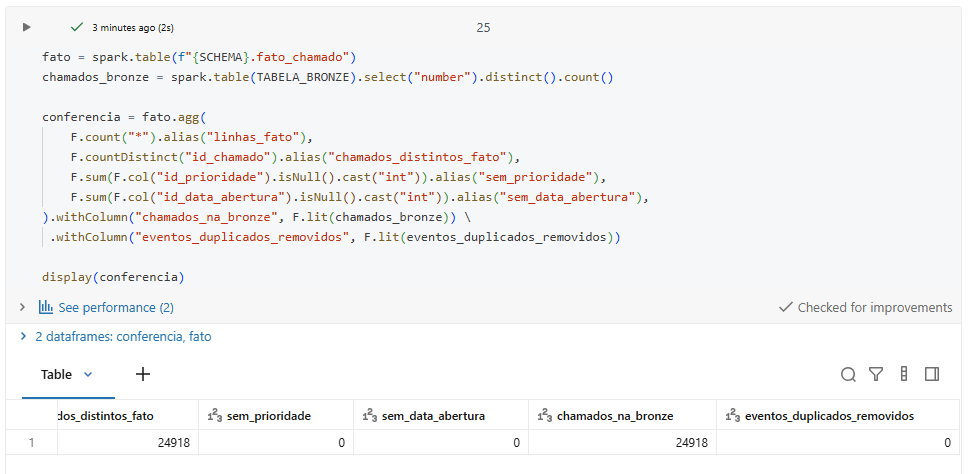
- Consulta SQL usando o modelo estrela (fato + dimensão de prioridade, célula 12):
  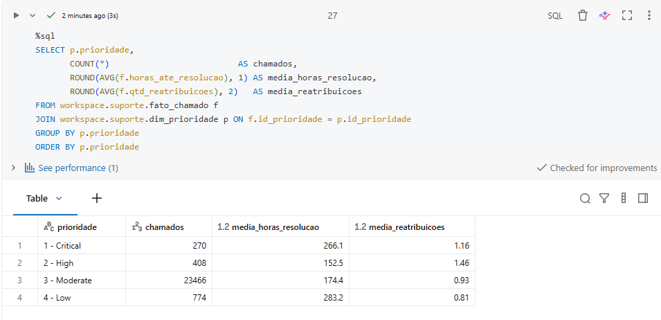

---

## 5. Análise
### 5.1 Qualidade dos dados

Notebook: [`notebooks/03_qualidade.py`](notebooks/03_qualidade.py) — explicação célula a célula em [`notebooks/03_qualidade_explicacao.md`](notebooks/03_qualidade_explicacao.md).
Resultado completo de cada verificação: tabela `workspace.suporte.qualidade_resultado` e arquivo
`evidencias/qualidade_resumo.csv`.

#### Resumo
Foram executadas 47 verificações nas seis dimensões de qualidade. A base é **bem curada**: não há falhas
de conversão, registros repetidos, valores categóricos fora do domínio (exceto um estado inválido raro)
nem datas fora do período esperado. Foram encontrados **quatro problemas** que afetam as perguntas, todos
tratados na carga (notebook 02) para não distorcer as respostas.

| Dimensão | Resultado |
|---|---|
| Completude | Nenhuma falha de conversão (0 de 5.101.632 valores). Colunas usadas nas perguntas sem ausentes, exceto `assigned_to` (19,4%), `assignment_group` (10,0%), `resolved_at` (2,2%) e `category` (0,06%). Cinco colunas não usadas estão quase 100% vazias |
| Unicidade | 0 eventos idênticos; 0 chamados repetidos na fato; 0 chaves repetidas nas dimensões |
| Conformidade | Prioridade, impacto, urgência e canal 100% dentro do domínio. Formatos de `number`, `category`, `assignment_group` e `assigned_to` 100% corretos. `incident_state` tem 5 eventos com o valor inválido `-100` |
| Consistência | Nenhum chamado resolvido antes de abrir ou fechado antes de resolver; data de abertura estável em todos os chamados. 2 chamados com primeiro atendimento antes da abertura; 1.556 chamados (6,24%) com estado final "Resolved"/"Closed" mas sem data de resolução |
| Acurácia | Todas as medidas dentro dos limites do catálogo, exceto os 2 tempos negativos de primeiro atendimento (mínimo −2,45 h). Maior tempo de resolução: 8.070 h (cerca de 336 dias) |
| Atualidade | Chamados abertos de 29/02/2016 a 16/02/2017, cerca de um ano de operação; nenhum fora do período |

#### Problemas encontrados e tratamento

| # | Problema | Tamanho | Efeito se não tratado | Tratamento |
|---|---|---|---|---|
| 1 | Estado inválido `-100` em `incident_state` | 5 eventos (0,004%) | Seria contado como "primeiro atendimento" (pergunta 1) | **R6** passou a considerar só estados válidos diferentes de "New". Os eventos continuam na base, porque as demais colunas deles são válidas |
| 2 | Primeiro atendimento antes da abertura | 2 chamados (0,01%) | Tempos negativos puxariam a média da pergunta 1 para baixo | **R13**: tempos negativos viram nulo e ficam fora das médias |
| 3 | Chamados fechados sem data de resolução | 1.556 chamados (6,24%) | Seriam contados como "não resolvidos" na pergunta 3, embora estejam fechados | **R10** passou a usar o estado final: todo chamado "Resolved" ou "Closed" é resolvido. Como a data de resolução não existe, `horas_ate_resolucao` fica nulo para esses chamados, que ficam fora das perguntas 2 e 5. Não usamos `closed_at` no lugar, porque o fechamento costuma acontecer dias depois da resolução e inflaria os tempos |
| 4 | `assigned_to` e `assignment_group` ausentes em parte dos eventos | 19,4% e 10,0% dos eventos | Nenhum: a ausência é esperada nos primeiros eventos, antes de o chamado ser atribuído | Mantido. **R7** conta só valores preenchidos, então a ausência não infla o número de pessoas |

##### Verificação após o tratamento
Depois de aplicar R6, R10 e R13 e rodar o Job novamente, o notebook 03 foi executado outra vez
(`evidencias/qualidade_resumo_pos_tratamento.csv`). A verificação *horas_ate_primeiro_atendimento abaixo
de 0* passou de **2 para 0**. As demais contagens não mudaram, como esperado: elas medem os dados de origem
(o problema continua existindo na fonte), e o tratamento acontece na tabela fato.

##### Pontos de atenção para a análise (não são erros)
- **Concentração de prioridade:** 94% dos chamados são "3 - Moderate" (23.466 de 24.918). As prioridades
  1, 2 e 4 têm poucas centenas de chamados cada, então comparações entre elas devem ser lidas com cautela.
- **Concentração de canal:** 99% dos eventos vêm de "Phone"; o canal não diferencia os chamados.
- **Tempos muito longos:** alguns chamados levam centenas de horas e puxam a média para cima. Por isso a
  análise usa também a **mediana**, que representa melhor o chamado típico.
- **Colunas não usadas e quase vazias** (`caused_by`, `vendor`, `cmdb_ci`, `rfc`, `problem_id`): ficam na
  camada prata, mas não entram no modelo nem nas perguntas.
- **Período de um ano:** os dados cobrem de fevereiro de 2016 a fevereiro de 2017; tendências de longo
  prazo não podem ser avaliadas.

#### Análise por atributo (36 atributos da fonte, camada prata)

| Atributo | Usado nas perguntas | Tipo | Preenchidos | % ausente | Distintos | Mínimo | Máximo | Observação |
|---|---|---|---|---|---|---|---|---|
| `number` | Sim | string | 141.712 | 0% | 24.918 | INC0000045 | INC0121064 | Sem ausentes; 24.918 chamados; formato INC + 7 dígitos em 100% dos valores |
| `incident_state` | Sim | string | 141.712 | 0% | 9 | -100 | Resolved | 5 eventos com o valor inválido `-100` (fora do domínio) |
| `active` | Não | boolean | 141.712 | 0% | 2 | false | true | Sem problemas encontrados |
| `reassignment_count` | Sim | int | 141.712 | 0% | 28 | 0 | 27 | 0 a 27, dentro do domínio |
| `reopen_count` | Sim | int | 141.712 | 0% | 9 | 0 | 8 | 0 a 8, dentro do domínio |
| `sys_mod_count` | Sim | int | 141.712 | 0% | 115 | 0 | 129 | 0 a 129, dentro do domínio |
| `made_sla` | Não | boolean | 141.712 | 0% | 2 | false | true | Sem problemas encontrados |
| `caller_id` | Não | string | 141.683 | 0,02% | 5.244 | Caller 10 | Caller 999 | Sem problemas encontrados |
| `opened_by` | Não | string | 136.877 | 3,41% | 207 | Opened by  10 | Opened by  94 | 3% ausente; espaço duplo nos valores ("Opened by  10"); não usado |
| `opened_at` | Sim | timestamp | 141.712 | 0% | 19.849 | 2016-02-29 01:16:00 | 2017-02-16 14:17:00 | 29/02/2016 a 16/02/2017; nenhuma falha de conversão |
| `sys_created_by` | Não | string | 88.636 | 37,45% | 185 | Created by 1 | Created by 99 | 37% ausente; não usado |
| `sys_created_at` | Não | timestamp | 88.636 | 37,45% | 11.552 | 2016-02-29 01:23:00 | 2017-01-27 16:59:00 | 37% ausente; não usado |
| `sys_updated_by` | Não | string | 141.712 | 0% | 846 | Updated by 1 | Updated by 996 | Sem problemas encontrados |
| `sys_updated_at` | Sim | timestamp | 141.712 | 0% | 50.664 | 2016-02-29 01:23:00 | 2017-02-18 15:00:00 | Sem ausentes; usado para o primeiro atendimento |
| `contact_type` | Sim | string | 141.712 | 0% | 5 | Direct opening | Self service | 5 valores, todos no domínio; 99% Phone |
| `location` | Não | string | 141.636 | 0,05% | 224 | Location 10 | Location 99 | Sem problemas encontrados |
| `category` | Sim | string | 141.634 | 0,06% | 58 | Category 10 | Category 9 | 78 eventos sem categoria (0,06%) |
| `subcategory` | Não | string | 141.601 | 0,08% | 254 | Subcategory 10 | Subcategory 99 | Sem problemas encontrados |
| `u_symptom` | Não | string | 108.748 | 23,26% | 525 | Symptom 10 | Symptom 99 | 23% ausente; não usado |
| `cmdb_ci` | Não | string | 445 | 99,69% | 50 | cmdb_ci 10 | cmdb_ci 9 | Quase 100% ausente; não usado |
| `impact` | Não | string | 141.712 | 0% | 3 | 1 - High | 3 - Low | Sem problemas encontrados |
| `urgency` | Não | string | 141.712 | 0% | 3 | 1 - High | 3 - Low | Sem problemas encontrados |
| `priority` | Sim | string | 141.712 | 0% | 4 | 1 - Critical | 4 - Low | 4 valores, todos no domínio; 93% Moderate |
| `assignment_group` | Sim | string | 127.499 | 10,03% | 78 | Group 10 | Group 9 | 10% dos eventos sem grupo (chamado ainda não atribuído) |
| `assigned_to` | Sim | string | 114.216 | 19,4% | 234 | Resolver 10 | Resolver 99 | 19% dos eventos sem responsável (chamado ainda não atribuído) |
| `knowledge` | Não | boolean | 141.712 | 0% | 2 | false | true | Sem problemas encontrados |
| `u_priority_confirmation` | Não | boolean | 141.712 | 0% | 2 | false | true | Sem problemas encontrados |
| `notify` | Não | string | 141.712 | 0% | 2 | Do Not Notify | Send Email | Sem problemas encontrados |
| `problem_id` | Não | string | 2.295 | 98,38% | 252 | Problem ID  10 | Problem ID  99 | 98% ausente; não usado |
| `rfc` | Não | string | 991 | 99,3% | 181 | CHG0000047 | CHG0003516 | 99% ausente; não usado |
| `vendor` | Não | string | 244 | 99,83% | 4 | Vendor 1 | code 8s | Quase 100% ausente; contém o valor estranho "code 8s"; não usado |
| `caused_by` | Não | string | 23 | 99,98% | 3 | CHG0000097 | CHG0001327 | Quase 100% ausente; não usado |
| `closed_code` | Não | string | 140.998 | 0,5% | 17 | code 1 | code 9 | Sem problemas encontrados |
| `resolved_by` | Não | string | 141.486 | 0,16% | 216 | Resolved by 10 | Resolved by 99 | Sem problemas encontrados |
| `resolved_at` | Sim | timestamp | 138.571 | 2,22% | 18.505 | 2016-02-29 09:04:00 | 2017-02-17 00:47:00 | 2,2% dos eventos sem data; 1.556 chamados fechados sem data de resolução |
| `closed_at` | Não | timestamp | 141.712 | 0% | 2.707 | 2016-02-29 17:47:00 | 2017-02-18 15:00:00 | Sem problemas encontrados |

#### Perfil dos atributos do modelo (tabela fato)
Valores medidos **antes** dos ajustes R6, R10 e R13; depois deles, `horas_ate_primeiro_atendimento` passa a
ter mínimo 0.

| Atributo | Tipo | Preenchidos | Distintos | Mínimo | Máximo |
|---|---|---|---|---|---|
| `id_chamado` | string | 24.918 | 24.918 | INC0000045 | INC0121064 |
| `id_prioridade` | int | 24.918 | 4 | 1 | 4 |
| `id_categoria` | int | 24.911 | 52 | 1 | 52 |
| `id_canal` | int | 24.918 | 5 | 1 | 5 |
| `id_data_abertura` | int | 24.918 | 207 | 20160229 | 20170216 |
| `data_hora_abertura` | timestamp | 24.918 | 19.849 | 2016-02-29 01:16:00 | 2017-02-16 14:17:00 |
| `data_hora_primeiro_atendimento` | timestamp | 24.918 | 19.152 | 2016-02-29 05:30:00 | 2017-02-16 14:17:00 |
| `data_hora_resolucao` | timestamp | 23.362 | 18.505 | 2016-02-29 09:04:00 | 2017-02-17 00:47:00 |
| `horas_ate_primeiro_atendimento` | double | 24.918 | 5.223 | -2.45 | 5885.9 |
| `horas_ate_resolucao` | double | 23.362 | 9.694 | 0.0 | 8070.17 |
| `foi_resolvido` | boolean | 24.918 | 2 | false | true |
| `qtd_reaberturas` | int | 24.918 | 7 | 0 | 8 |
| `foi_reaberto` | boolean | 24.918 | 2 | false | true |
| `qtd_reatribuicoes` | int | 24.918 | 22 | 0 | 27 |
| `qtd_pessoas_envolvidas` | bigint | 24.918 | 7 | 0 | 6 |
| `qtd_grupos_envolvidos` | bigint | 24.918 | 9 | 0 | 8 |
| `qtd_atualizacoes` | int | 24.918 | 103 | 1 | 129 |

#### Evidências
- Resumo das verificações (célula 8):
  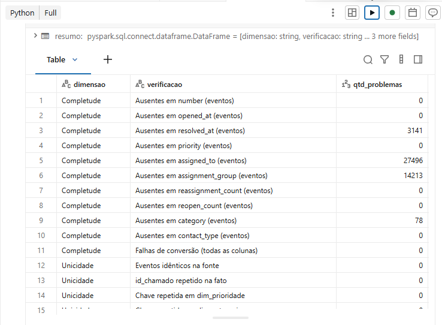
- Completude por coluna (célula 2):
  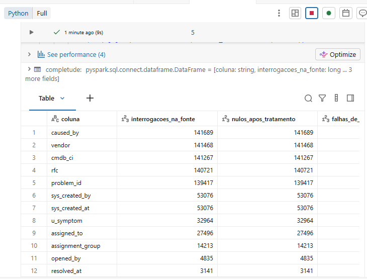
- Perfil de valores por atributo (célula 2b):
  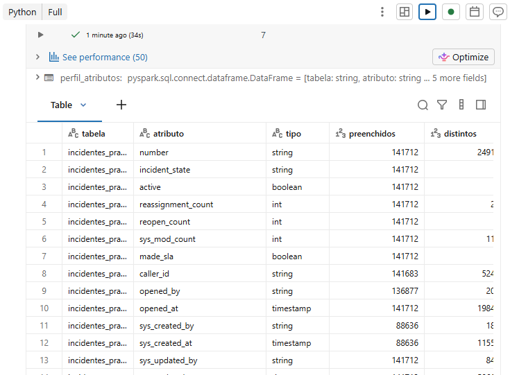
- Valores encontrados nos atributos categóricos (célula 4):
  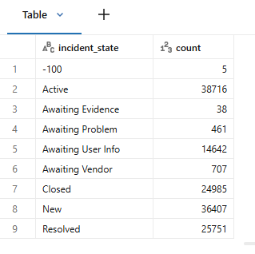
  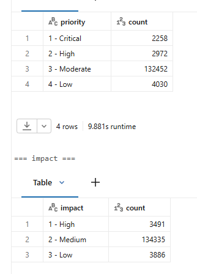
  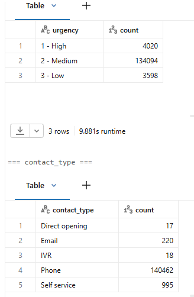
- Tabelas completas em CSV: `evidencias/qualidade_resumo.csv`, `evidencias/qualidade_completude.csv`,
  `evidencias/qualidade_perfil_atributos.csv`.

### 5.2 Respostas às perguntas

Todos os números abaixo vêm do notebook `04_analise`. As tabelas usadas também foram salvas no
Databricks como `workspace.suporte.resp_p1_…` até `resp_p5_…`, e cada uma tem um CSV na pasta
`/evidencias`.

Duas medidas aparecem em quase todas as respostas:
- **Mediana:** o tempo do chamado "do meio". Metade dos chamados leva menos que isso e metade leva mais.
- **P90:** 90% dos chamados levam até esse tempo.

Usamos a mediana como medida principal porque poucos chamados muito demorados puxam a média para cima.
A resolução mais longa da base, por exemplo, levou 8.070 h.

#### Pergunta 1 — Quanto tempo até o primeiro atendimento?

| Prioridade | Chamados | Média (h) | Mediana (h) | P90 (h) |
|---|---|---|---|---|
| 1 - Critical | 270 | 24,0 | 1,0 | 71,8 |
| 2 - High | 408 | 53,8 | 4,5 | 115,6 |
| 3 - Moderate | 23.464 | 44,4 | 0,3 | 94,0 |
| 4 - Low | 774 | 20,8 | 0,1 | 66,2 |
| **Todas** | **24.916** | **43,6** | **0,4** | **93,4** |

| Faixa de tempo | Chamados | % |
|---|---|---|
| Menos de 1 h | 14.783 | 59,3% |
| De 1 a 4 h | 2.281 | 9,2% |
| De 4 a 24 h | 2.855 | 11,5% |
| De 1 a 3 dias | 2.029 | 8,1% |
| Mais de 3 dias | 2.968 | 11,9% |

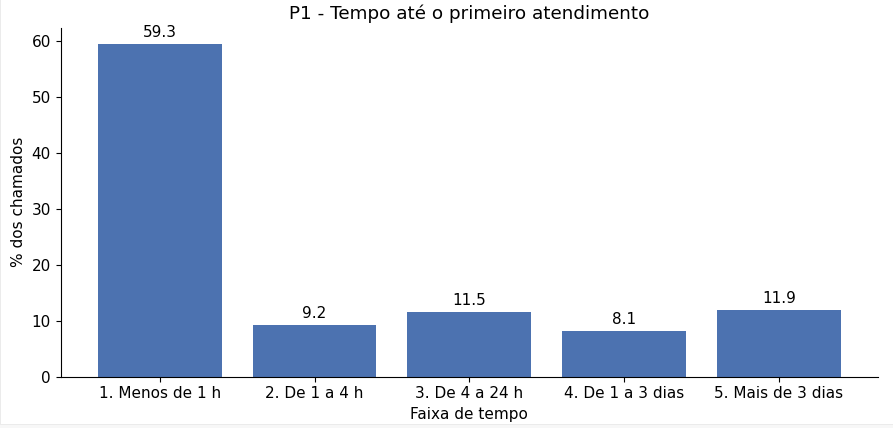

**Resposta:** a maioria dos chamados é atendida rápido. A mediana é de 0,4 h (cerca de 24 minutos) e
59,3% recebem o primeiro atendimento em menos de 1 hora. Por outro lado, 11,9% esperam mais de 3 dias.

**Discussão:**
- A distribuição tem dois grupos: um grande, atendido quase na hora, e uma "cauda" de chamados que
  esperam dias. Por isso a média (43,6 h) é mais de 100 vezes maior que a mediana.
- Os chamados **Critical** não são os mais rápidos: a mediana deles (1,0 h) é maior que a de
  Moderate (0,3 h) e a de Low (0,1 h). Uma explicação possível é que chamados críticos passam
  primeiro por uma triagem. Os dados não mostram isso diretamente, então é uma suposição.
- Dois chamados não entram nesta tabela (24.916 de 24.918). O primeiro atendimento deles aparecia
  antes da abertura, então o valor foi anulado na regra R13.

#### Pergunta 2 — Quanto tempo até a resolução, por prioridade?

| Prioridade | Chamados com data de resolução | Média (h) | Mediana (h) | Mediana (dias) | P90 (h) |
|---|---|---|---|---|---|
| 1 - Critical | 270 | 266,1 | 79,1 | 3,3 | 616,4 |
| 2 - High | 408 | 152,5 | 36,4 | 1,5 | 381,6 |
| 3 - Moderate | 22.010 | 174,4 | 21,5 | 0,9 | 372,5 |
| 4 - Low | 674 | 283,2 | 5,0 | 0,2 | 503,1 |
| **Todas** | **23.362** | **178,2** | **22,1** | **0,9** | **381,3** |

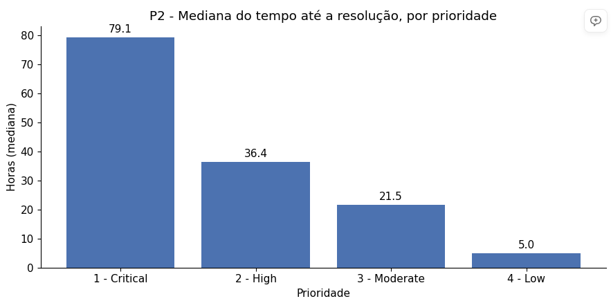

**Resposta:** o chamado típico é resolvido em cerca de 22 horas (mediana de 0,9 dia). Quanto mais
alta a prioridade, **mais tempo** a resolução leva: Critical tem mediana de 79,1 h e Low, de 5,0 h.

**Discussão:**
- O resultado é o contrário do que se esperaria se prioridade significasse "resolver mais rápido".
  Uma leitura possível é que a prioridade reflete a **gravidade e a complexidade** do problema:
  problemas críticos são mais difíceis e por isso demoram mais. Isso é uma interpretação; a base não
  diz por que cada chamado recebeu sua prioridade.
- Os chamados Low são um caso à parte. A mediana deles é a menor (5 h), mas a média é a maior
  (283,2 h). A maioria é resolvida rápido, e alguns poucos ficam parados por muito tempo.
- 94% dos chamados são Moderate. Por isso, as comparações entre prioridades têm grupos de tamanhos
  muito diferentes: só 270 chamados são Critical.
- 1.556 chamados terminam como resolvidos, mas não têm data de resolução (ver 5.1). Eles ficaram de
  fora desta conta, e por isso o total é 23.362, não 24.918.

#### Pergunta 3 — Que proporção é resolvida, e quantos são reabertos?

| Medida | Valor |
|---|---|
| Chamados | 24.918 |
| Terminam como resolvidos (estado final *Resolved* ou *Closed*) | 24.918 (100%) |
| Têm data de resolução registrada | 23.362 (93,8%) |
| Foram reabertos pelo menos uma vez | 275 (1,1%) |

| Prioridade | Chamados | % reabertos |
|---|---|---|
| 1 - Critical | 270 | 0,00% |
| 2 - High | 408 | 1,23% |
| 3 - Moderate | 23.466 | 1,14% |
| 4 - Low | 774 | 0,26% |

| Reaberturas | Chamados | % |
|---|---|---|
| 0 | 24.643 | 98,90% |
| 1 | 245 | 0,98% |
| 2 | 19 | 0,08% |
| 3 ou mais | 11 | 0,04% |

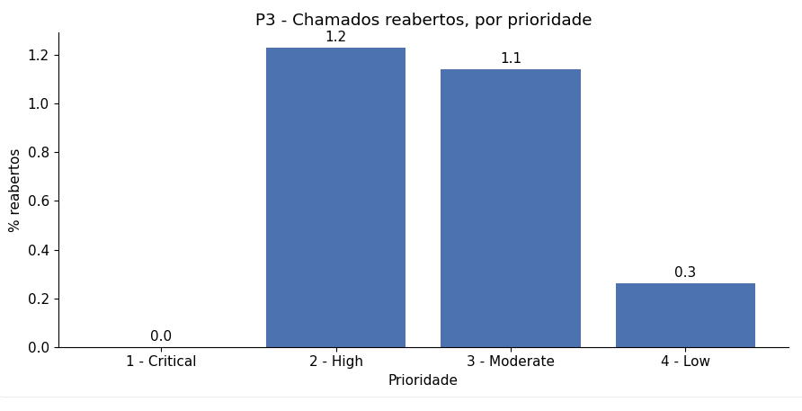

**Resposta:** todos os chamados da base terminam como resolvidos, e só 1,1% precisou ser reaberto.

**Discussão:**
- O valor de 100% não quer dizer que a empresa resolve tudo. A base é um registro de chamados **já
  encerrados**, então ela não contém chamados que ainda estavam abertos ou que foram abandonados.
  Esse é um limite da fonte, e não dá para medir a taxa real de resolução com ela.
- A taxa de reabertura é baixa em todas as prioridades. Nenhum chamado Critical foi reaberto.
- Um chamado foi reaberto 8 vezes. É um caso isolado, mas mostra que existem chamados que "voltam"
  repetidamente.

#### Pergunta 4 — Quantas vezes o chamado é repassado, e quantas pessoas se envolvem?

| Medida (por chamado) | Média | Mediana | Máximo |
|---|---|---|---|
| Reatribuições | 0,94 | 0 | 27 |
| Pessoas diferentes envolvidas | 1,11 | 1 | 6 |
| Grupos diferentes envolvidos | 1,55 | 1 | 8 |

| Reatribuições | % dos chamados | | Pessoas envolvidas | % dos chamados |
|---|---|---|---|---|
| 0 | 54,4% | | 0 | 2,6% |
| 1 | 25,0% | | 1 | 85,9% |
| 2 | 9,2% | | 2 | 9,7% |
| 3 | 5,0% | | 3 | 1,4% |
| 4 ou mais | 6,5% | | 4 ou mais | 0,3% |

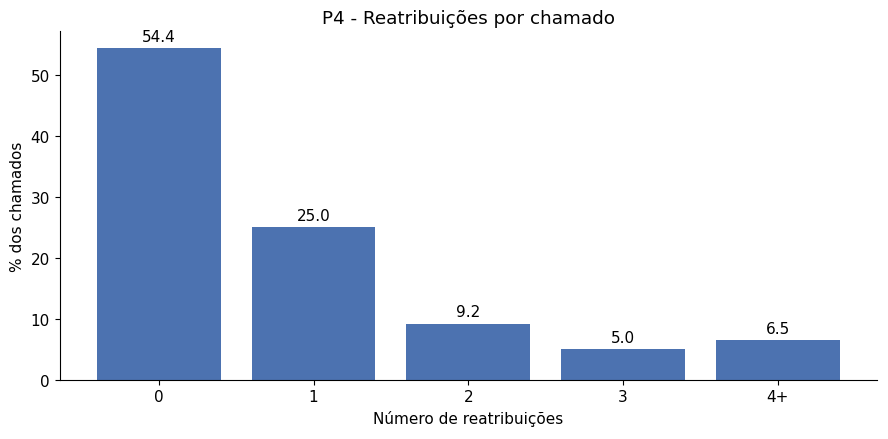
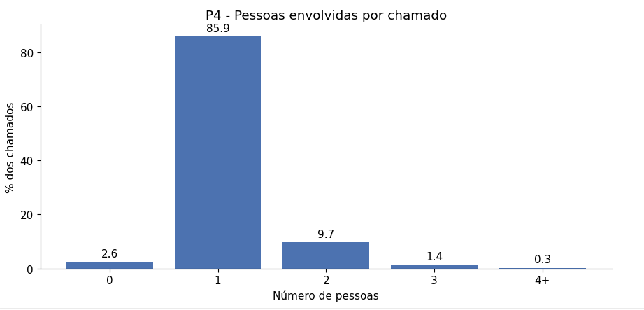

**Resposta:** a maioria dos chamados não é repassada. 54,4% nunca são reatribuídos e 85,9% envolvem
uma única pessoa. Ainda assim, 6,5% são repassados 4 vezes ou mais, e um deles chegou a 27 repasses.

**Discussão:**
- Há mais reatribuições do que pessoas novas. Isso indica que o chamado muitas vezes troca de
  **grupo** (a média é de 1,55 grupos) e volta para pessoas que já tinham atuado nele.
- "0 pessoas" (2,6%) quer dizer que o campo do responsável (`assigned_to`) nunca foi preenchido
  naquele chamado. Isso foi visto na etapa de qualidade (5.1): o campo está vazio em 19,4% dos eventos.

#### Pergunta 5 — Mais reatribuições e mais pessoas significam resolução mais lenta?

Esta pergunta testa a hipótese. Para isolar o efeito da prioridade, os resultados são mostrados para
todos os chamados e também **só para os de prioridade Moderate**. Assim, a comparação é feita entre
chamados de mesma prioridade, como a hipótese pede.

**Mediana do tempo de resolução por número de reatribuições**

| Reatribuições | Chamados | Mediana (h), todas | Média (h), todas | Mediana (h), só Moderate |
|---|---|---|---|---|
| 0 | 12.003 | 0,7 | 95,0 | 0,6 |
| 1 | 6.228 | 42,0 | 173,3 | 42,5 |
| 2 | 2.283 | 103,0 | 315,6 | 113,2 |
| 3 | 1.234 | 146,1 | 372,6 | 146,3 |
| 4 ou mais | 1.614 | 239,2 | 472,5 | 241,6 |

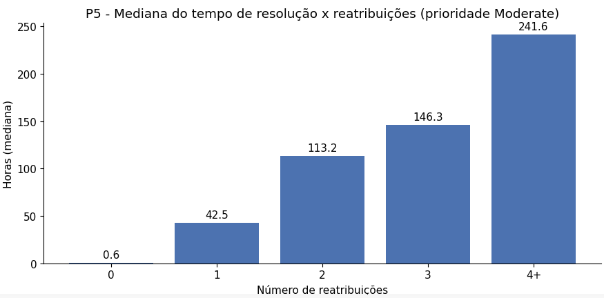

**Mediana do tempo de resolução por número de pessoas envolvidas**

| Pessoas | Chamados | Mediana (h), todas | Média (h), todas | Mediana (h), só Moderate |
|---|---|---|---|---|
| 0 | 585 | 7,3 | 25,5 | 7,9 |
| 1 | 19.921 | 8,0 | 135,0 | 7,4 |
| 2 | 2.427 | 167,8 | 455,3 | 168,2 |
| 3 | 342 | 359,0 | 810,7 | 343,3 |
| 4 ou mais | 87 | 573,0 | 863,1 | 573,0 |

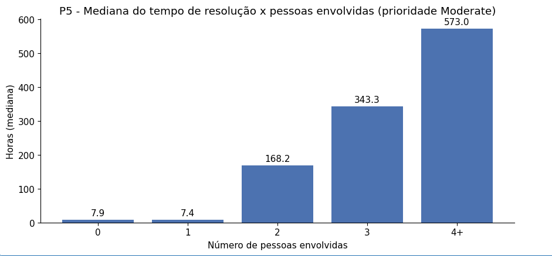

**Correlação de Spearman com o tempo de resolução**

A correlação de Spearman vai de -1 a 1 e mede se, quando um número sobe, o outro também tende a subir.
Perto de 0 quer dizer que não há relação, e perto de 1, que a relação é forte.

| Grupo | Medida | Spearman | Chamados |
|---|---|---|---|
| Todas as prioridades | Reatribuições | 0,528 | 23.362 |
| Todas as prioridades | Pessoas envolvidas | 0,317 | 23.362 |
| Todas as prioridades | Grupos envolvidos | 0,448 | 23.362 |
| Somente Moderate | Reatribuições | **0,542** | 22.010 |
| Somente Moderate | Pessoas envolvidas | **0,318** | 22.010 |
| Somente Moderate | Grupos envolvidos | **0,458** | 22.010 |

**Resposta:** sim. Quanto mais o chamado é repassado, mais ele demora, e isso continua valendo entre
chamados de mesma prioridade.
- Nos chamados Moderate, a mediana sobe de 0,6 h (sem repasse) para 42,5 h com 1 repasse e chega a
  241,6 h com 4 repasses ou mais.
- Com pessoas, o salto acontece quando entra a **segunda** pessoa: a mediana vai de cerca de 7 h para
  168 h, e chega a 573 h com 4 pessoas ou mais.

**Discussão:**
- A relação é **moderada** para reatribuições (Spearman de 0,54) e **fraca a moderada** para pessoas
  (0,32). As reatribuições se relacionam melhor com o tempo do que o número de pessoas.
- Os valores quase não mudam quando olhamos só os chamados Moderate (0,528 → 0,542). Isso mostra que
  a relação **não é explicada pela prioridade**.
- Sobre a palavra "significativamente" da hipótese: com cerca de 22 mil chamados, uma correlação de
  0,54 está muito longe do zero. Fiz a conta à parte com o teste t usual para correlação, que não está
  no notebook: o valor fica dezenas de erros-padrão acima de zero. Na prática, a chance de esse
  resultado ser obra do acaso é desprezível.
- **Correlação não é causa.** A relação pode funcionar nos dois sentidos:
  - repassar o chamado faz ele demorar, porque cada pessoa ou grupo novo precisa entender o problema;
  - ou um chamado que já está demorando (por ser difícil) tem mais tempo e mais motivo para ser
    repassado.
  Os dados mostram que as duas coisas andam juntas, mas não dizem qual causa qual.

### 5.3 Discussão geral

A pergunta norteadora era: o que faz um chamado demorar para ser resolvido, a prioridade, o quanto ele
é escalado ou quantas pessoas se envolvem?

**A hipótese foi confirmada.** Chamados repassados mais vezes demoram bem mais para serem
resolvidos, e isso continua valendo entre chamados da mesma prioridade (Moderate). Das três
explicações da pergunta norteadora, a que mais se relaciona com a demora é o **número de
reatribuições** (Spearman de 0,54). Depois vêm o número de grupos (0,46) e o número de pessoas
(0,32).

**A prioridade não explica a demora como se esperava.** Os chamados Critical são os que mais demoram
para ser resolvidos (mediana de 79 h, contra 5 h dos Low). A prioridade parece indicar a gravidade
ou a complexidade do problema, e não um prazo menor de atendimento.

**O que isso significa para a empresa:**
- Metade dos chamados é resolvida sem repasse, quase na hora: a mediana desses chamados é de 0,7 h.
- Cada repasse acrescenta horas ou dias. Um chamado que entra para a segunda pessoa passa de cerca de
  7 h para mais de 160 h de mediana.
- Encaminhar o chamado logo para o grupo certo, por exemplo com uma triagem melhor na abertura, tende
  a ser a ação com maior potencial de reduzir a demora. Isso é uma recomendação baseada em correlação;
  confirmar o efeito exigiria um teste na prática.

**Limitações:**
- A base tem apenas chamados encerrados, então não mede a taxa real de resolução (pergunta 3).
- 1.556 chamados (6,2%) não têm data de resolução e ficaram fora das contas de tempo.
- 94% dos chamados são Moderate e 99% chegam por telefone. Os grupos menores (Critical, High, Low)
  têm poucos chamados para comparações finas.
- A base é anonimizada e de uma única empresa, de 2016 a 2017. Os resultados podem não valer para
  outras empresas.
- A análise mostra relação, não causa (ver pergunta 5).

### 5.4 Viabilidade e custo de operação

A seção 1.2 do enunciado pede que o MVP mostre três tipos de viabilidade.

| Dimensão | Evidência neste MVP | Situação |
|---|---|---|
| Viabilidade técnica | O pipeline roda de ponta a ponta no Databricks. O Job `01_coleta → 02_carga → 03_qualidade → 04_analise` executou com sucesso em 4 min 38 s (`evidencias/carga_job_execucao.png`). | Atendida. |
| Viabilidade financeira | Custo real de zero, porque o MVP rodou no Databricks Free Edition. Para uso contínuo, segue uma estimativa abaixo, com o preço oficial por DBU. | Atendida como estimativa: o preço é oficial, mas o consumo é suposto, não medido. |
| Desejabilidade | As 5 perguntas foram respondidas com dados e discutidas (5.2 e 5.3). | Atendida em parte: as perguntas vieram do problema, mas nenhum usuário real (por exemplo, um gestor de suporte) validou se essas respostas são as que ele precisa. |

#### Custo real do MVP
O custo foi **zero**. Todo o trabalho rodou no **Databricks Free Edition**, que não tem cobrança.

O Free Edition tem limites ([documentação oficial](https://docs.databricks.com/aws/en/getting-started/free-edition-limitations)):
- usa apenas computação serverless;
- tem uma cota diária de uso, e passar dela desliga a computação até o dia seguinte;
- permite no máximo 5 tarefas de Job rodando ao mesmo tempo;
- **não pode ser usado para fins comerciais**.

Ou seja, ele serve para o MVP, mas não para uma empresa operar o pipeline de verdade.

#### Estimativa para uso contínuo em uma conta paga
O Databricks cobra por **DBU** (*Databricks Unit*, uma unidade de consumo de processamento). O custo
de cada execução é:

> custo por execução = DBUs consumidos × preço por DBU

O preço foi conferido na [página de preços de Jobs](https://www.databricks.com/product/pricing/lakeflow-jobs)
em outubro de 2026: **Jobs Serverless custa a partir de US$ 0,35 por DBU**, já incluindo a
infraestrutura de nuvem.

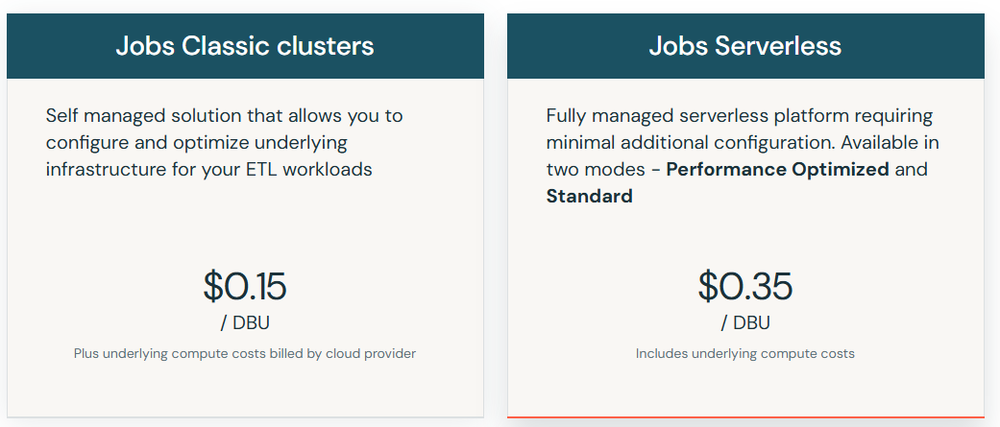

A estimativa tem duas limitações:
- O Free Edition **não mostra** quantos DBUs cada execução consumiu, então o consumo abaixo é uma
  **suposição**.
- US$ 0,35 é o preço **inicial**. O valor final pode ser maior conforme a nuvem, a região, o plano e
  o modo escolhido (*Performance Optimized* ou *Standard*). O Job deste MVP rodou com o modo
  *Performance Optimized* ligado, que prioriza velocidade. Como o pipeline não tem pressa (roda uma vez
  por dia), usar o modo *Standard* seria uma forma simples de reduzir o custo.

| Premissa | Cenário baixo | Cenário alto |
|---|---|---|
| Execuções do pipeline completo por mês (1 por dia) | 30 | 30 |
| DBUs por execução (suposição, para um Job serverless curto, como o de 4 min 38 s com as 4 tarefas) | 0,5 | 2 |
| Preço por DBU (preço inicial do Jobs Serverless, conferido no site) | US$ 0,35 | US$ 0,35 |
| **Processamento por mês** | **≈ US$ 5** | **≈ US$ 21** |
| Armazenamento (dados abaixo de 1 GB, a cerca de US$ 0,02 a 0,03 por GB por mês em armazenamento de nuvem) | < US$ 0,10 | < US$ 0,10 |

**Leitura:** com esses números, operar o pipeline custaria entre **US$ 5 e 21 por mês**.
É um valor pequeno perto do problema que ele ajuda a enxergar. A análise mostrou que um chamado que
passa para uma segunda pessoa sobe de cerca de 7 h para mais de 160 h de mediana até a resolução.

O que esta estimativa **não inclui**:
- as horas de quem mantém o pipeline;
- a integração com o sistema de chamados real;
- um painel para os gestores;
- o crescimento do volume de dados.

Esses custos tendem a ser maiores que o custo de processamento.

---

## 6. Autoavaliação

### 6.1 Quais perguntas foram respondidas, e quais não foram? Por quê?

| Pergunta | Situação | Por quê |
|---|---|---|
| 1. Tempo até o primeiro atendimento | Respondida, com uma ressalva | A base não tem um campo "primeiro atendimento". Usamos como aproximação o primeiro evento em que o chamado sai do estado *New* (regra R6). Isso mede quando o chamado começou a ser tratado no sistema, não necessariamente quando alguém falou com o cliente. |
| 2. Tempo até a resolução, por prioridade | Respondida | O resultado não era o esperado: os chamados Critical são os mais lentos. Ficaram fora da conta 1.556 chamados (6,2%) sem data de resolução. |
| 3. Proporção resolvida e reabertos | **Respondida só em parte** | A parte dos reabertos foi respondida (1,1%). A proporção resolvida **não pôde ser medida de verdade**: a base só contém chamados encerrados, então o resultado de 100% é um efeito da fonte, não um indicador de desempenho. |
| 4. Repasses e pessoas envolvidas | Respondida, com uma ressalva | A base não diferencia "escalar" (subir para um nível mais especializado) de "repassar" (trocar de responsável ou de grupo). Usamos o contador `reassignment_count` para os dois. Portanto, a pergunta sobre escalonamento foi respondida de forma aproximada. |
| 5. Mais reatribuições e pessoas → resolução mais lenta? | Respondida | A hipótese foi confirmada como **relação** (Spearman de 0,54 nos chamados Moderate). Mas a análise **não prova causa**, e o teste de que a correlação não é obra do acaso foi feito fora do notebook. |

Nenhuma pergunta foi removida do objetivo, como o enunciado pede.

### 6.2 Que limitações dos dados condicionaram os resultados?
- **Só chamados encerrados.** Isso impede medir a taxa real de resolução e pode deixar de fora
  justamente os chamados mais problemáticos, como os abandonados.
- **Tempo corrido, não tempo útil.** As horas foram calculadas do relógio, contando noites, fins de
  semana e o tempo em que o chamado esperava resposta do próprio cliente (estado *Awaiting User Info*).
  Parte da "demora" pode não ser culpa do suporte. Esse ponto pode ter inflado os tempos dos chamados
  repassados, se eles também esperam mais pelo cliente.
- **Distribuição muito desigual.** 94% dos chamados são Moderate e 99% chegaram por telefone. Isso
  deixa as comparações entre prioridades e canais com grupos pequenos (só 270 chamados Critical) e
  impede analisar o efeito do canal.
- **Campos incompletos.** O responsável (`assigned_to`) está vazio em 19,4% dos eventos, o que pode
  ter subestimado o número de pessoas envolvidas. 1.556 chamados não têm data de resolução.
- **Base anonimizada, de uma única empresa e de um ano (2016–2017).** Não sabemos que empresa é, que
  tipo de software ela atende nem como define cada prioridade. Os resultados podem não valer para
  outros contextos.

### 6.3 Que decisões técnicas eu tomaria de outra forma?
- **Calcular tempo útil** (horário comercial) e **descontar o tempo de espera pelo cliente**. Isso
  separaria a demora do suporte da demora do cliente e deixaria o teste da hipótese mais justo.
- **Montar o Job completo desde o início.** No começo, o Job tinha só coleta e carga, e os notebooks
  de qualidade e análise rodavam à mão. Eles só entraram no Job no fim do trabalho.
- **Fazer as verificações de qualidade interromperem o Job** quando encontrarem um problema grave.
  Hoje elas só registram o resultado na tabela `qualidade_resultado`, e a análise roda mesmo que algo
  esteja errado.
- **Guardar o arquivo original em um volume**, em vez de criar a tabela pelo upload da interface. O
  upload detectou os tipos das colunas sozinho, e o arquivo bruto exato não ficou guardado na nuvem.
- **Colocar o teste estatístico dentro do notebook**, com um intervalo de confiança para a correlação,
  em vez de fazer a conta à parte.
- **Conectar o Databricks ao GitHub** (Git folders) desde o início, em vez de copiar os arquivos à
  mão. Isso teria evitado o erro da célula de texto que virou código no notebook de coleta.

### 6.4 Que extensões transformariam este MVP em uma solução de uso contínuo?
- **Ingestão automática e incremental** a partir do sistema de chamados (por exemplo, pela API do
  ServiceNow), com o Job agendado para rodar todo dia.
- **Painel para os gestores** (por exemplo, no Databricks SQL), com tempo de atendimento, tempo de
  resolução e repasses por prioridade e por grupo, além de alertas quando um chamado passar de um
  limite de repasses.
- **Indicadores de SLA**, ou seja, metas de prazo por prioridade, calculadas em tempo útil.
- **Um modelo que preveja**, na abertura, quais chamados têm maior chance de serem repassados, para
  encaminhá-los direto ao grupo certo.
- **Um experimento controlado** para testar se a relação é de causa. Por exemplo, aplicar uma triagem
  melhor em parte dos chamados e comparar o tempo de resolução com os demais.
- **Monitoramento contínuo da qualidade dos dados** e **controle de acesso**, porque dados reais de
  chamados podem ter informações de clientes.

---

## 7. Estrutura do repositório

| Caminho | Conteúdo |
|---|---|
| `README.md` | Documento principal: objetivo, perguntas, metodologia, resultados e autoavaliação |
| `/notebooks` | Notebooks de coleta, transformação, carga e análise (formato Databricks) |
| `/scripts` | Código auxiliar |
| `/catalogo` | Catálogo de Dados e diagrama do modelo estrela |
| `/evidencias` | Capturas de tela que comprovam a execução na nuvem |
| `LICENSE` | Licença do código (MIT) e registro da licença dos dados (CC BY 4.0) |

### Como reproduzir
1. Baixe a base na [página do UCI](https://archive.ics.uci.edu/dataset/498/incident+management+process+enriched+event+log)
   e envie o `incident_event_log.csv` ao Databricks em *New → Add or upload data → Create or modify table*,
   no catálogo `workspace`, schema `default`.
2. Importe os notebooks da pasta `/notebooks` no Databricks (*Workspace → Import*).
3. Crie um Job com quatro tarefas de notebook em sequência, `01_coleta` → `02_carga` → `03_qualidade` → `04_analise`
   (cada uma dependendo da anterior), e clique em **Run now**. Também é possível rodar os notebooks manualmente, na ordem numérica.
