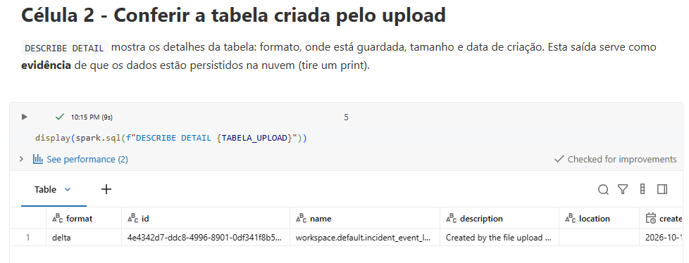
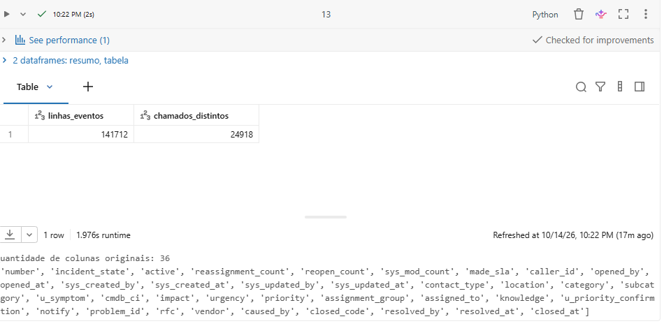
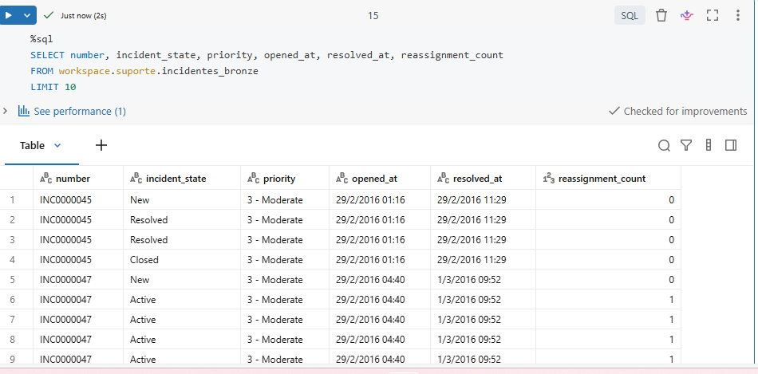
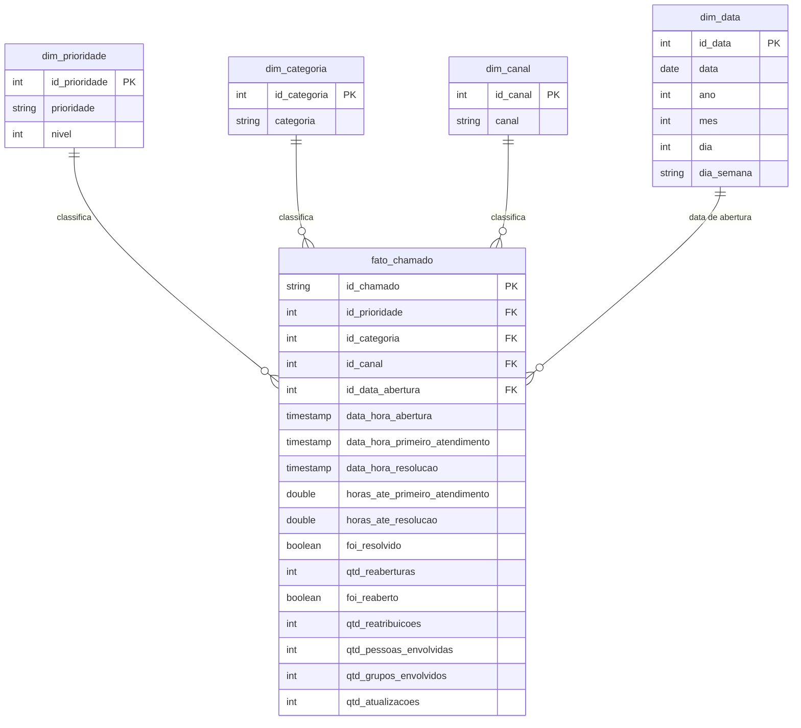

# MVP — O que faz um chamado de suporte demorar?

Trabalho final da disciplina (MVP), Departamento de Engenharia de Produção — Universidade de Brasília.
Pipeline de dados em nuvem (Databricks) sobre chamados de suporte de uma empresa de TI.

**Autora:** Amanda

## Sumário
1. [Objetivo](#1-objetivo)
2. [Coleta](#2-coleta)
3. [Modelagem](#3-modelagem)
4. [Carga](#4-carga)
5. [Análise](#5-análise)
6. [Autoavaliação](#6-autoavaliação)
7. [Estrutura do repositório](#7-estrutura-do-repositório)

---

## 1. Objetivo

### Pergunta norteadora
O que faz um chamado de suporte demorar para ser resolvido: a prioridade dele, o quanto ele precisa
ser escalado, ou quantas pessoas precisam se envolver até a solução?

### Problema
Empresas de software recebem chamados de clientes todos os dias. Quando um chamado demora para ser
atendido ou resolvido, ou passa por muitas mãos, o cliente fica insatisfeito e o custo do atendimento
sobe. Este MVP busca entender como o tempo de atendimento se relaciona com a prioridade, com o
aprofundamento (escalonamento) e com o número de pessoas envolvidas, para apoiar decisões sobre onde
melhorar o processo de suporte.

### Hipótese
Chamados que precisam ser escalados ou repassados mais vezes demoram significativamente mais para
serem resolvidos, mesmo quando comparados com chamados de mesma prioridade.

### Perguntas de negócio
1. Quanto tempo um chamado leva, desde a abertura, até receber o primeiro atendimento?
2. Quanto tempo um chamado leva até ser resolvido, e como esse tempo varia por prioridade?
3. Que proporção dos chamados é de fato resolvida, e quantos precisam ser reabertos depois de dados
   como resolvidos?
4. Até ser resolvido, quantas vezes um chamado é repassado ou escalado e quantas pessoas diferentes
   acabam se envolvendo nele?
5. Mais reatribuições e mais pessoas envolvidas significam uma resolução mais lenta?

---

## 2. Coleta

| Item | Registro |
|---|---|
| Base | Incident management process enriched event log |
| Fonte | [UCI Machine Learning Repository](https://archive.ics.uci.edu/dataset/498/incident+management+process+enriched+event+log) |
| Origem dos dados | Log de eventos real e anonimizado de chamados de uma empresa de TI, extraído da plataforma ServiceNow |
| Autores (citação) | Amaral, C.; Fantinato, M.; Peres, S. (2018) |
| Licença | [Creative Commons Attribution 4.0 International (CC BY 4.0)](https://creativecommons.org/licenses/by/4.0/legalcode): permite compartilhar e adaptar para qualquer finalidade, com o crédito apropriado |
| Data da coleta | 14/10/2026, às 21:45 |
| Arquivo obtido | `incident_event_log.csv` (CSV dentro de um .zip), 44,1 MB |
| Volume | 141.712 linhas (eventos), 24.918 chamados distintos, 36 colunas originais |
| Envio à nuvem | Upload pela interface do Databricks (*Create table*), gerando a tabela Delta `workspace.default.incident_event_log` |
| Tabela bruta do trabalho | `workspace.suporte.incidentes_bronze` (cópia fiel + colunas de linhagem `_data_carga` e `_arquivo_origem`) |

Notebook: [`notebooks/01_coleta.py`](notebooks/01_coleta.py) — explicação célula a célula em
[`notebooks/01_coleta_explicacao.md`](notebooks/01_coleta_explicacao.md).

**Evidências**

Detalhes da tabela criada pelo upload (formato Delta, persistida no catálogo):

Volume coletado:

Consulta SQL à tabela bruta:

---

## 3. Modelagem

A base original é um log de eventos (cada linha é uma atualização de um chamado). Como as perguntas
falam sobre chamados, o modelo é um **Esquema Estrela** com uma tabela fato de **uma linha por
chamado**, ligada a quatro dimensões.

| Pergunta | Medida da fato | Dimensão |
|---|---|---|
| 1. Tempo até o primeiro atendimento | `horas_ate_primeiro_atendimento` | `dim_prioridade` |
| 2. Tempo até a resolução, por prioridade | `horas_ate_resolucao` | `dim_prioridade` |
| 3. Proporção resolvida e reabertos | `foi_resolvido`, `foi_reaberto`, `qtd_reaberturas` | — |
| 4. Repasses e pessoas envolvidas | `qtd_reatribuicoes`, `qtd_pessoas_envolvidas`, `qtd_grupos_envolvidos` | — |
| 5. Reatribuições e pessoas x tempo | `qtd_reatribuicoes`, `qtd_pessoas_envolvidas` x `horas_ate_resolucao` | `dim_prioridade` |

Detalhes do modelo e regras de negócio: [`catalogo/modelo_dados.md`](catalogo/modelo_dados.md).
Catálogo de Dados (tipos, domínios e linhagem): [`catalogo/catalogo_dados.md`](catalogo/catalogo_dados.md).

---

## 4. Carga
*Em construção.*

## 5. Análise
### 5.1 Qualidade dos dados
*Em construção.*

### 5.2 Respostas às perguntas
*Em construção.*

### 5.3 Discussão geral
*Em construção.*

## 6. Autoavaliação
*Em construção.*

---

## 7. Estrutura do repositório

| Caminho | Conteúdo |
|---|---|
| `README.md` | Documento principal: objetivo, perguntas, metodologia, resultados e autoavaliação |
| `/notebooks` | Notebooks de coleta, transformação, carga e análise (formato Databricks) |
| `/scripts` | Código auxiliar |
| `/catalogo` | Catálogo de Dados e diagrama do modelo estrela |
| `/evidencias` | Capturas de tela que comprovam a execução na nuvem |
| `LICENSE` | Licença do código (MIT) e registro da licença dos dados (CC BY 4.0) |

### Como reproduzir
1. Baixe a base na [página do UCI](https://archive.ics.uci.edu/dataset/498/incident+management+process+enriched+event+log)
   e envie o `incident_event_log.csv` ao Databricks em *New → Add or upload data → Create or modify table*,
   no catálogo `workspace`, schema `default`.
2. Importe os notebooks da pasta `/notebooks` no Databricks (*Workspace → Import*) e rode-os na ordem numérica.
