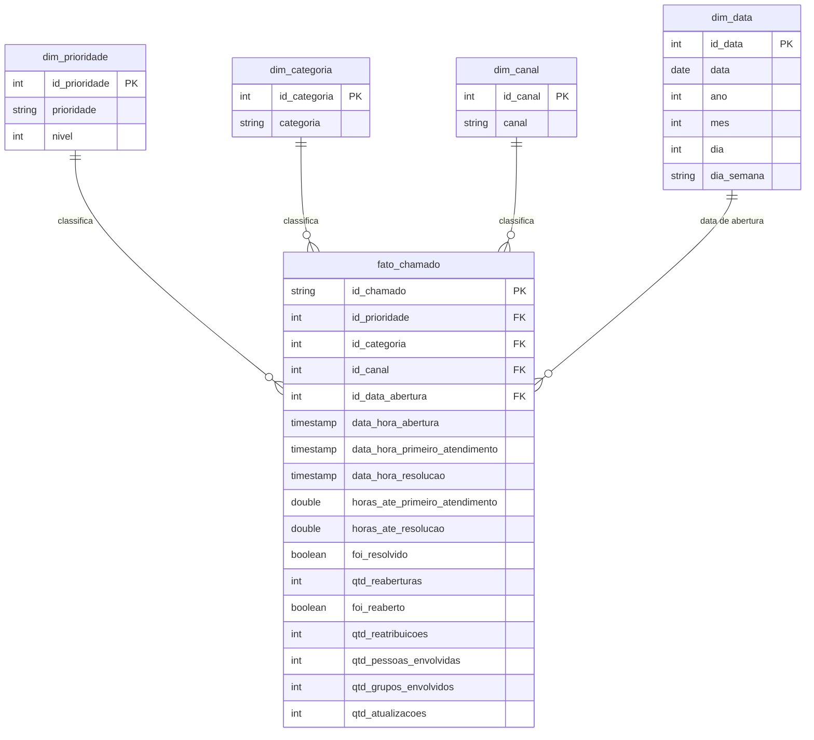

# Modelagem dos dados

## Escolha do modelo: Esquema Estrela
A base original é um **log de eventos**: cada linha é uma atualização de um chamado, e o mesmo chamado
aparece várias vezes (141.712 linhas para 24.918 chamados). As perguntas do objetivo, porém, falam sobre
**chamados** (quanto tempo levou, quantas pessoas envolveu). Por isso o modelo tem uma tabela fato com
**uma linha por chamado**, cercada de dimensões que descrevem o chamado.

O Esquema Estrela foi escolhido por ser simples de consultar com SQL: cada pergunta vira uma consulta à
tabela fato, filtrada ou agrupada por uma dimensão.

## Camadas do pipeline
| Camada | Tabela | Conteúdo |
|---|---|---|
| Bronze (bruto) | `workspace.suporte.incidentes_bronze` | Cópia fiel do CSV, uma linha por evento |
| Prata (tratado) | `workspace.suporte.incidentes_prata` | Eventos com `?` convertido em nulo, tipos corrigidos e duplicados removidos |
| Ouro (modelo estrela) | `fato_chamado` e `dim_*` | Uma linha por chamado, com as medidas já calculadas |

## Diagrama

## Tabelas

### `fato_chamado` (uma linha por chamado)
Guarda as **medidas** que respondem às perguntas: tempos, se foi resolvido, reaberturas, reatribuições e
pessoas envolvidas. As colunas `id_*` ligam o chamado às dimensões.

### `dim_prioridade`
Prioridade do chamado (1 - Critical, 2 - High, 3 - Moderate, 4 - Low). A coluna `nivel` guarda só o
número, para ordenar os resultados do mais ao menos urgente.

### `dim_categoria`
Categoria do chamado (anonimizada na fonte, ex.: "Category 55").

### `dim_canal`
Canal pelo qual o chamado foi aberto (Phone, Email, Self service, IVR, Direct opening).

### `dim_data`
Calendário da data de abertura, para analisar por ano, mês ou dia da semana.

## Como cada pergunta usa o modelo
| Pergunta | Medida da fato | Dimensão |
|---|---|---|
| 1. Tempo até o primeiro atendimento | `horas_ate_primeiro_atendimento` | `dim_prioridade` |
| 2. Tempo até a resolução, por prioridade | `horas_ate_resolucao` | `dim_prioridade` |
| 3. Proporção resolvida e reabertos | `foi_resolvido`, `foi_reaberto`, `qtd_reaberturas` | — |
| 4. Repasses e pessoas envolvidas | `qtd_reatribuicoes`, `qtd_pessoas_envolvidas`, `qtd_grupos_envolvidos` | — |
| 5. Reatribuições e pessoas x tempo | `qtd_reatribuicoes`, `qtd_pessoas_envolvidas` x `horas_ate_resolucao` | `dim_prioridade` (para comparar dentro da mesma prioridade) |

## Regras de negócio que a modelagem define
Estas regras serão aplicadas no notebook de Carga (ETL) e explicadas lá:

1. **Estado final do chamado:** é a linha com o maior `sys_mod_count` (última atualização). Prioridade,
   categoria, canal e contadores vêm dessa linha.
2. **Primeiro atendimento:** a base não tem essa data pronta. Usamos como aproximação o **primeiro evento
   em que o estado deixa de ser "New"**. Essa limitação será registrada na autoavaliação.
3. **Pessoas envolvidas:** número de valores distintos e não vazios de `assigned_to` ao longo de todos os
   eventos do chamado. Grupos envolvidos: o mesmo, com `assignment_group`.
4. **Resolvido:** chamado cujo estado final é "Resolved" ou "Closed" (regra R10 da carga). Chamados resolvidos sem data de resolução ficam com o tempo nulo.
5. **Valores ausentes:** o texto `?` da fonte é convertido em nulo.
6. **Datas:** convertidas do texto `d/M/yyyy HH:mm` para data e hora.
